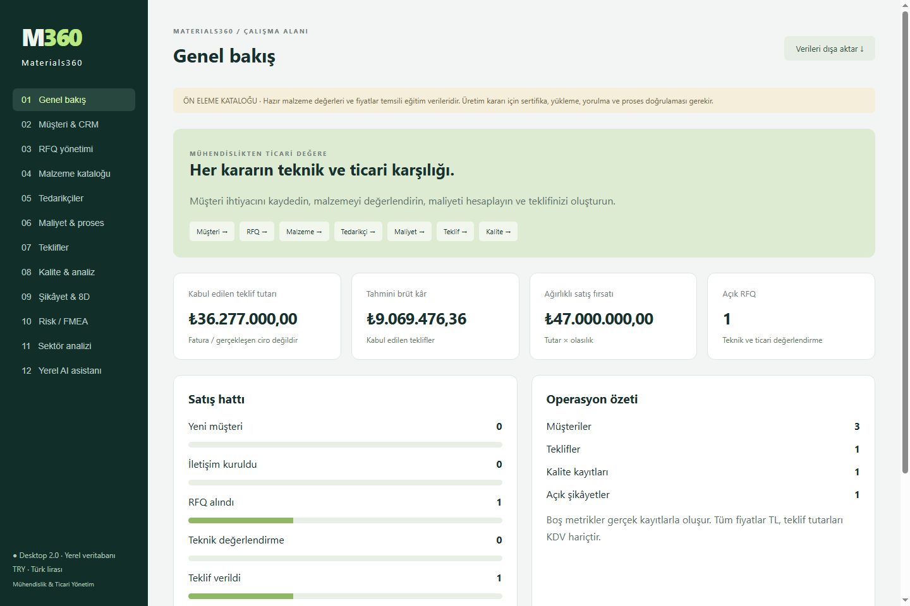
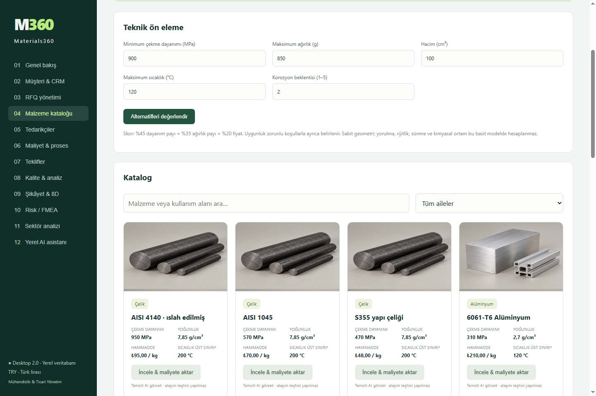
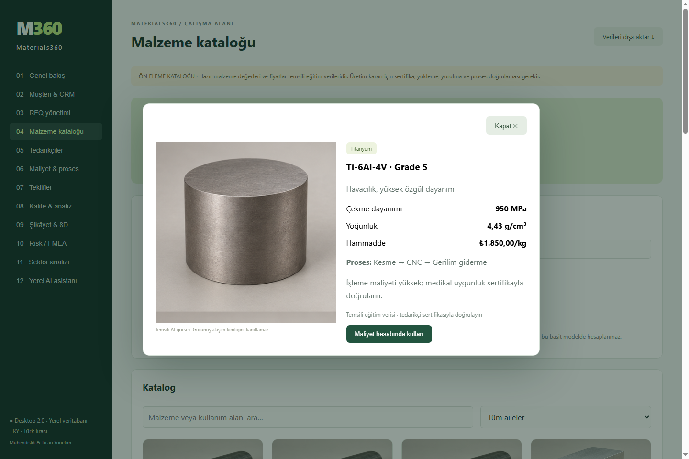
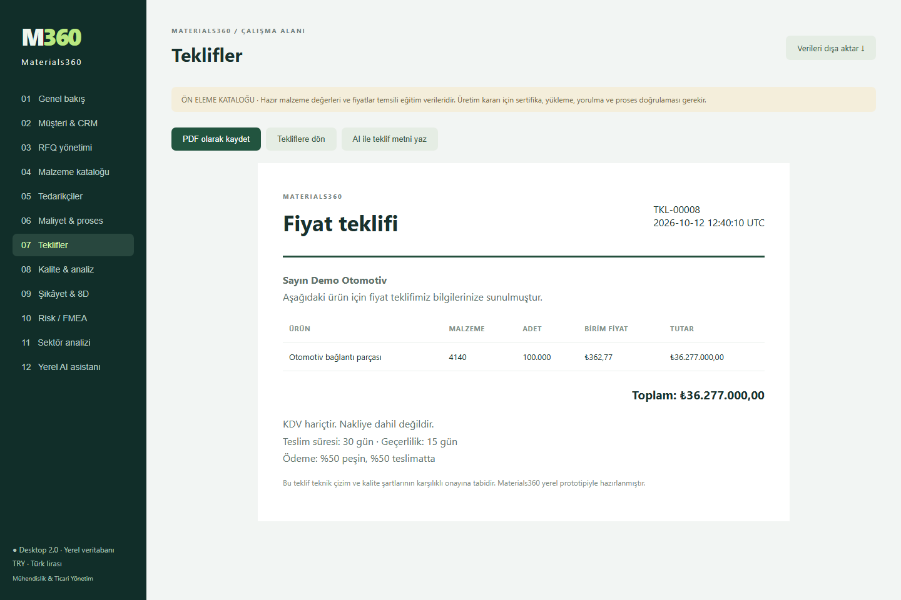
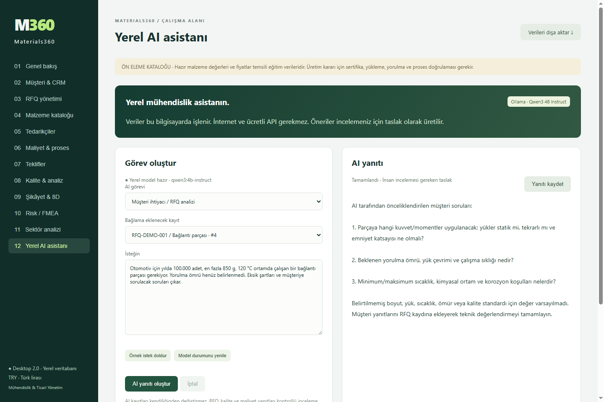

# Materials360

**Engineering & Commercial Intelligence Platform — Türk lirası ile çalışan masaüstü uygulaması**

Materials360, müşteri ihtiyacını malzeme seçimi, tedarikçi değerlendirmesi, üretim maliyeti, teknik teklif ve kalite kayıtlarıyla birleştirir. Electron ile kendi masaüstü penceresinde çalışır; verileri yerel SQLite veritabanında saklar. Yerel yapay zekâ desteği için Ollama ve Qwen kullanır.

## Birlikte geliştirdik

**Bu proje Oğuz ve Elif Özer tarafından birlikte geliştirildi. Elif Özer, projenin birçok aşamasında yardımcı olarak çalışmanın ortaya çıkmasına önemli katkı sağladı.** Materials360, birlikte yürüttüğümüz bir mühendislik ve yazılım projesidir; Elif Özer'in desteği ve katkıları bu çalışmanın önemli bir parçasıdır.

## Ekran görüntüleri

Görüntüler, uygulamanın masaüstü sürümünden örnek verilerle alınmıştır. Görünen şirketler, talepler ve maliyetler demo senaryosudur.

### Yönetim ekranı



### Fotoğraflı malzeme kataloğu



### Malzeme detayları



### Teknik teklif



### Yerel yapay zekâ asistanı



## Neler yapar?

- **Müşteri ve CRM:** satış aşamaları, fırsat tutarları ve kazanma olasılıkları.
- **RFQ:** teknik ihtiyaç, adet, dayanım, ağırlık, sıcaklık, hedef maliyet ve teslim süresi.
- **Malzeme seçimi:** 20 hazır metal, polimer ve kompozit; zorunlu koşullara göre ön eleme ve aday karşılaştırması.
- **Görsel katalog:** malzeme ailesi filtresi, detay ekranı, özel malzeme ve fotoğraf ekleme.
- **Tedarikçiler:** aynı malzeme için kalite, fiyat, teslim ve termin karşılaştırması.
- **Maliyet ve fiyatlandırma:** fire, işleme, işçilik, ısıl işlem, yüzey işlemi, kalite, paketleme, hazırlık ve genel gider; TL bazında brüt marj hesabı.
- **Teklif:** müşteri teklifleri, durum takibi ve masaüstünden PDF kaydetme.
- **Kalite:** ölçüm analizi, Pp/Ppk, uygunsuz sayısı, 8D çalışma kayıtları ve temel FMEA/RPN.
- **Yönetim:** kabul edilen teklif toplamı, tahmini brüt kâr, ağırlıklı satış fırsatı ve portföyden sektör görünümü.
- **Yerel AI:** eksik RFQ bilgileri, malzeme alternatiflerinin açıklanması, teklif metni taslakları, kalite inceleme planları ve maliyet iyileştirme fikirleri.
- **Yedekleme:** yerel kayıtları JSON olarak dışa aktarma.

## Kurulum ve çalıştırma

Gerekli araçlar: [Node.js 24 veya üzeri](https://nodejs.org/en/download), Git ve npm. Electron `npm ci` ile kurulur.

```powershell
git clone https://github.com/Mrhandle12/Materials360.git
cd Materials360
npm ci
npm start
```

`npm start` masaüstü penceresini, yerel veri motorunu ve varsa Ollama motorunu başlatır. Uygulama verileri `data/` altında saklanır.

Örnek şirket, RFQ, teklif ve kalite kayıtlarıyla incelemek için:

```powershell
npm run demo
```

Demo verileri ayrı `data-demo/` klasörüne yazılır. Demo başlangıcı mevcut demo kayıtlarını silmez. Kaynak depo müşteri veritabanı, kişisel kayıtlar veya model ağırlıkları içermez.

### İsteğe bağlı yerel AI kurulumu

1. [Ollama](https://ollama.com/download) kurun.
2. Uygulamayı `npm start` ile açın. Uygulama, AI motoruna `127.0.0.1:11435` üzerinden bağlanır ve kurulu Ollama'yı başlatmayı dener.
3. Ayrı bir PowerShell penceresinde modeli indirin:

```powershell
$env:OLLAMA_HOST = '127.0.0.1:11435'
ollama pull qwen3:4b-instruct
```

İlk model indirmesi internet gerektirir. Ardından çıkarım yerel olarak yapılır; API anahtarı ve API kullanım ücreti gerekmez. Model yaklaşık 2,5 GB'dır; hız ve bellek ihtiyacı donanıma bağlıdır. AI olmadan diğer modüller çalışır.

Mevcut Ollama motorunu varsayılan portunda kullanmak için uygulamayı aynı terminalden şöyle başlatabilirsiniz:

```powershell
$env:M360_AI_ENDPOINT = 'http://127.0.0.1:11434'
npm start
```

Özel kurulumlarda `M360_OLLAMA` ile Ollama çalıştırılabilir dosyasını, `OLLAMA_MODELS` ile model klasörünü belirleyebilirsiniz. Diğer ayarlar [kurulum notlarında](docs/SETUP.md) açıklanır.

## Hesapların çalışma şekli

```text
Müşteri → CRM → RFQ → Malzeme → Tedarikçi → Proses / maliyet
       → Satış fiyatı → Teklif → Kalite → Müşteri geri bildirimi
```

```text
Satın alınan kütle = net kütle / (1 − fire oranı)
İşleme maliyeti = süre (dk) / 60 × makine saat ücreti
Birim hazırlık maliyeti = toplam hazırlık / sipariş adedi
Satış fiyatı = birim maliyet / (1 − hedef brüt marj)
```

Malzeme ön elemesi dayanım, geometriye bağlı ağırlık, sıcaklık ve korozyon koşullarını denetler. Koşulları sağlayamayan bir aday, yüksek puan aldığı için uygun kabul edilmez. Kompozitlerde laminat ve yük yönü ayrıca doğrulanmalıdır.

## Teknik yapı

| Katman | Kullanılan teknoloji |
| --- | --- |
| Masaüstü | Electron; izole preload ve PDF dışa aktarma |
| Arayüz | HTML, CSS, JavaScript |
| Veri motoru | Node.js 24, yerel HTTP ve oturum anahtarı |
| Veri tabanı | SQLite, `node:sqlite` |
| Mühendislik | JavaScript ile deterministik hesap motoru |
| Yerel AI | Ollama + Qwen3 4B Instruct |
| Doğrulama | Node.js test runner |

## Testler

```powershell
npm test
```

Sekiz test; maliyet ve marj hesabı, geçersiz girdiler, zorunlu malzeme koşulları, kompozit sınırları, özel malzemeler, AI görev sınırları, ölçüm istatistikleri ve veri motoru entegrasyonunu kapsar. Entegrasyon testi ayrıca oturum koruması, fotoğraf kaydı, sunucuda yeniden hesaplanan teklif, yedekleme ve yeniden başlatma sonrası kalıcılığı denetler.

## Prototip kapsamı

Hazır malzeme özellikleri, fiyatlar ve görsel numuneler eğitim ve ön eleme amaçlıdır. Katalog görselleri yapay zekâ ile hazırlanmış temsili malzeme görselleridir; kullanıcı kendi gerçek numune fotoğrafını ekleyebilir. Üretim kararında sertifika, yükleme, yorulma, kimyasal ortam ve proses verileri doğrulanmalıdır.

AI çıktıları insan incelemesi gereken taslaklardır. RFQ, kalite ve maliyet görevlerinde model kontrollü kategorileri seçer; sayısal maliyetler hesap motorundan gelir. AI kendi başına teklif göndermez veya kayıtları değiştirmez.

Bu sürüm tek bilgisayarda yerel kullanım içindir. Çok kullanıcılı yetkilendirme, e-fatura, CAD/ANSYS aktarımı ve canlı piyasa fiyatı entegrasyonu mevcut kapsamın dışındadır. Teklif tutarları KDV ve nakliye hariçtir. Kalite analizi toplam örnek standart sapmasıyla **Pp/Ppk** hesaplar.
